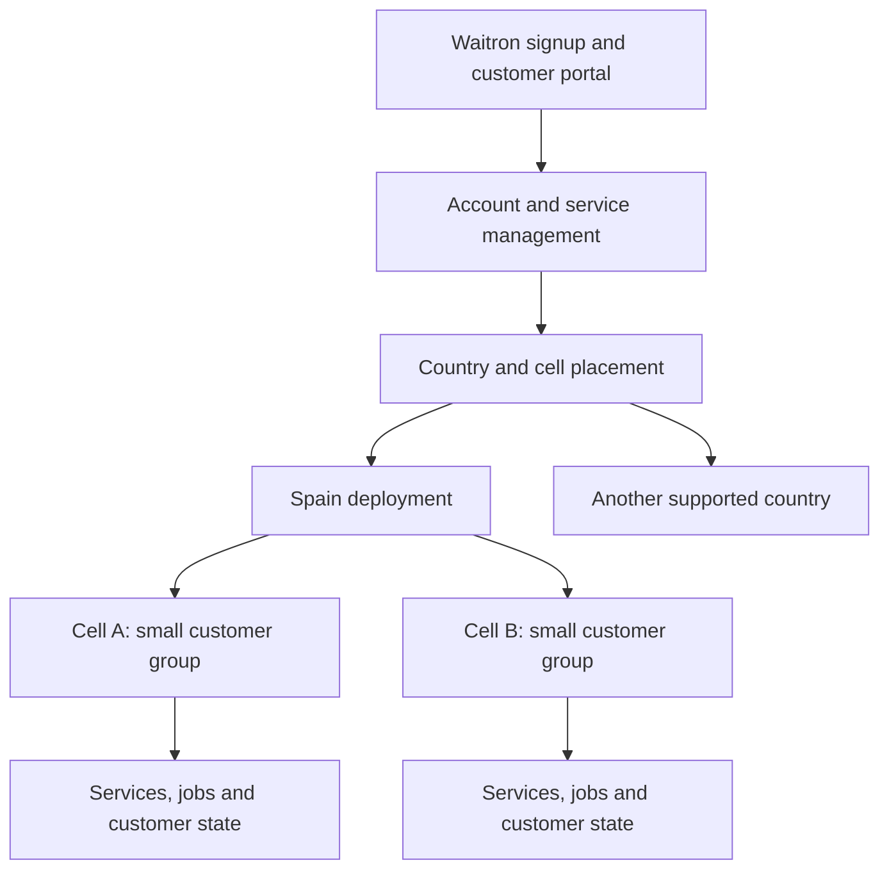

# Waitron Cloud: product and platform discussion

Status: brainstorm, 2026-09-22. The product requirements below come from the owner.
The platform structure and customer model include proposals for discussion; confirmed
requirements are identified below. Remote access and backups are the agreed initial
services. Their detailed scope, deployment architecture, pricing and implementation
sequence remain to be decided.

## The product

Waitron Cloud is a commercial, closed-source product. You can subscribe from your
existing Waitron installation to services that connect, protect and extend your venue.
You can also run Waitron itself in the cloud. A business with several venues can
manage them centrally.

Confirmed product principle: make as much as possible self-service, with the aim of
operating without a dedicated support team. You should be able to set up services,
manage accounts and billing, diagnose common problems, restore backups and cancel
services without staff intervention. Build clear status, actionable errors, guided
recovery and safe retries into those flows so you can resolve routine problems yourself.

Staff support is an exceptional fallback. Existing staff permissions and approved
support-access policies define how that fallback works; they do not imply that routine
customer journeys require staff or that a staffed support service is promised.

The owner wants customers divided into small deployment groups, called mini-zones,
across multiple availability zones. This should let operators upgrade a small group,
contain failures and move groups between hosts. The proposed residency policy is to
keep each country's customer data in that country. Spain is the confirmed first
deployment country and AWS the first provider. Keep the design able to support other
countries and Google Cloud later. Exact regions and service availability still need
verification against the residency policy before provisioning.

These are product requirements and proposed policies. They are not claims that every
country imposes the same legal storage obligation.

## Services a venue can buy

Remote access and backups are selected as the initial services. The wider catalogue
below describes possible scope; it does not set subscription plans or commit every
listed capability to the initial release.
The complete earlier inventory is in the [service inventory](reference/2026-08-29-cloud-services-inventory.md).

| Service family | What you get |
| --- | --- |
| Remote access | Reach the venue's dashboard and public pages from outside its network, with managed names and certificates. |
| Backup and recovery | Continuous SQLite backup through Litestream, retained snapshots, visible backup freshness and a tested restore procedure. |
| Cloud failover | Bring up a cloud primary after an on-prem primary fails, then return to the venue when appropriate. Promotion authority remains a design decision. |
| Hosted Waitron | Run a dedicated Waitron instance in the cloud, with local hardware integration where needed. |
| Bookings and ordering | Public table bookings, online ordering, digital menus and pay-at-table pages. |
| Fiscal archive | Retained invoices and associated records, export, and access granted by the owner to an advisor or tax authority such as AEAT. |
| Analytics and reporting | Search and analyse venue data, receive scheduled reports, and compare or aggregate several venues. Elasticsearch or a similar system is a candidate. |
| Multiple venues | Central visibility, catalogue and configuration distribution, and group management. |
| Messages and notifications | Administrative emails, receipts, booking messages and mobile notifications, with preferences and delivery status. |
| Monitoring and upgrades | Venue health, alerts, version visibility and controlled automatic upgrades. |
| Further candidates | Loyalty and gift cards, opening-hours publishing, delivery and accounting integrations, forecasting, benchmarking and managed device enrolment. |

The older inventory also records excluded or conditional ideas. Hardware fulfilment,
operating mailboxes and a booking marketplace should not silently become commitments
through this list. Pricing, support scope and operating costs need their own decisions.

## Initial product focus

Design the first experience for an owner with one venue, or several venues in the
same city. You connect your venue, enable remote access and backups, and can see
whether those services are working. Adding another venue should follow the same
simple flow.

Confirmed remote-access scope includes both owners and staff using Waitron remotely
and customers reaching public pages such as menus and bookings. The proposed access
model preserves Waitron's permissions for staff and exposes the intended public pages
to customers. The exact routes remain to be defined.

Confirmed initial availability policy: temporary unavailability is acceptable when
the venue server or its internet connection is down. This applies to staff access
and public pages, including bookings. The initial remote-access service depends on
the venue being online; serving cloud copies and accepting bookings while it is
offline remain future capabilities. Show a clear temporary-unavailability message
as the proposed customer experience. The independent Cloud management portal remains
available for account and service management, subject to its own availability.

Confirmed compromise: public pages terminate HTTPS in Cloud for bot and web-request
inspection, with an encrypted onward connection to your venue. Staff access uses a
separate hostname and TLS passthrough, keeping request contents encrypted until they
reach the venue. Cloud can inspect public-page traffic, including booking submissions;
staff request contents remain outside that inspection path.

Protect both entry points before forwarding traffic, with different controls. Public
access can use bot challenges and request-level limits. Staff passthrough can use
network filtering and connection limits; application-level checks run at the venue.
It therefore cannot offer the same cloud request inspection as public access.
The exact controls and capacity limits remain to be selected and tested.

The public route must expose only the intended public functionality. Define and test
hostname, route and session separation so it cannot become an alternative path into
staff functions. Prevent direct routes that bypass the intended protection, and monitor
rejected traffic and false positives. The gateway software and provider services remain
implementation choices. [Nginx documents TLS passthrough](https://nginx.org/en/docs/stream/ngx_stream_ssl_preread_module.html);
[AWS documents web-request inspection](https://docs.aws.amazon.com/waf/latest/developerguide/waf-chapter.html).

The initial backup service provides automatic continuous backups, retained snapshots,
visible backup health and a tested self-service restore path, with staff intervention
as an exceptional fallback. The recovery model below defines the purpose of each backup type;
retention periods and snapshot scheduling remain to be decided.

Keep the underlying organisation and legal-business model able to represent larger
customers from the outset. Detailed international administration, separate-approver
workflows and ownership transfers can be designed when needed; they should not
complicate the usual owner-led setup.

## Domains, certificates and local access

Provide an assigned Waitron hostname, such as `venue.waitron.io`, or instructions
for pointing your own domain to Cloud. The venue server must serve both local and
internet users over trusted HTTPS, with automated Let's Encrypt certificates.
The precise public, staff and local hostname layout remains to be designed.

The proposed certificate flow keeps staff private keys on the venue server and uses
DNS validation, with Cloud managing the validation records. Custom domains can
delegate the certificate-validation records. Let's Encrypt supports
[DNS validation and delegation](https://letsencrypt.org/docs/challenge-types/)
without requiring a publicly reachable web server.

Confirmed preference: use local DNS overrides so the registered staff hostname
resolves directly to the venue server on the LAN and to the passthrough gateway
over the internet. The venue serves a certificate for that hostname in both cases.
Public customer pages retain their separate hostname and cloud HTTPS termination.
This makes the registered staff hostname the intended everyday local address; the
role of `waitron.local` during initial setup and recovery remains to be decided.

Choose a setup path that fits the customer's router and devices. Prefer a hostname
override or domain-specific forwarding where supported. Google Wifi documents custom
DNS-server selection rather than individual overrides, so it may need a local DNS
service that answers Waitron names and forwards other queries. That would make other
network DNS queries depend on the service too. Document the setup and recovery steps
before offering it as a self-service path. See [Google's DNS settings](https://support.google.com/googlehome/answer/6274141?hl=en)
and [rebinding protection](https://support.google.com/googlehome/answer/9144137?hl=en).

Test local resolution and trusted HTTPS on freshly started devices during an internet
outage, including router filtering and devices that use their own DNS settings. The
router/device configuration, address stability and resolver failure behaviour remain
implementation work; the chosen approach must preserve internet-independent local trading.

Agreed evaluation: test the Plex approach as an additional option that may reduce
customer configuration. A public hostname resolves to the venue's private LAN address,
and the venue serves a publicly trusted certificate for that name. The client must
select the local or remote connection address; public DNS does not automatically
change its answer based on whether the client is inside the venue.

This is a candidate to test, with local DNS overrides still preferred for dependable
offline access. Verify router rebinding protection and fresh-device connections after
internet loss and DNS-cache expiry before claiming a complete solution. See
[Plex's secure-connection guidance](https://support.plex.tv/articles/206225077-how-to-use-secure-server-connections/)
and [Waitron's existing LAN HTTPS investigation](https://github.com/clintongormley/waitron/blob/main/docs/superpowers/specs/2026-09-08-handheld-app-store-and-kiosk-findings.md).

## Backups and self-service recovery

Confirmed recovery model: you normally restore the most recent recoverable version
from the continuous Litestream backup. Retained snapshots serve as point-in-time
archives and as a fallback if the continuous backup data disappears. A snapshot must
remain restorable without the continuous backup data it is intended to protect against
losing. Storage layout, deletion permissions and retention need to preserve that
independence; the exact mechanism remains to be designed and tested.

You can restore onto a replacement server yourself without waiting for staff approval
or assistance, subject to your account's recovery permissions.
The agreed journey is to install Waitron, sign into Cloud, choose your venue and
restore its backup. The proposed interface defaults to the latest recoverable
continuous backup and lets you explicitly choose a retained snapshot. Show the
recovery point's time before confirmation, so falling back to older data is visible.

Show the last successful backup and alert when backups stop. Prove the recovery path
by restoring onto a replacement machine, including a separate test with continuous
backup data missing. This verifies the intended snapshot fallback before offering it
to customers. Cloud owns backup selection and access; coordinate installation and
safe activation of the replacement with Waitron's recovery logic.

## Proposed customer and identity model

Start with a business account that subscribes and pays, people who belong to it, and
venues to which those people have permissions. Keep the business account distinct
from each taxpayer's legal identity, each venue, and the machines running that venue.
Confirmed requirement: one organisation must support several legal businesses with
different tax identities, potentially across countries, from the beginning. Most
customers will have one legal business. The agreed signup should create the simple
structure for you and expose additional businesses only when you need them. A venue
would belong to a legal business, which would belong to an organisation.

Confirmed requirement: a venue belongs to one Cloud organisation at a time. The
process for transferring a venue between organisations remains future design work.

A person could manage several businesses, and a business could give an accountant,
manager or other member different access to different venues. A cloud account,
a local staff identity and a box's machine credential need explicit relationships.
Matching email addresses alone must not grant access to a venue.

Confirmed identity boundary: your Cloud login is distinct from your local Waitron
staff login. Restaurant staff do not need Cloud accounts to use the till. As an owner
or manager, you can explicitly link your identities and use one Cloud login to manage
several venues, subject to your permissions. The linking mechanism remains to be
designed; an identity link must not itself grant additional permissions.

Waitron Cloud staff and administrators also need logins and permissions. This is a
confirmed requirement. The proposed model separates customer memberships from
permissions to operate the Cloud platform, so each can be granted and revoked
independently. For example, a billing role could handle subscriptions and an operations
role could manage cells. The exact roles and permitted actions remain to be agreed.

Confirmed support policy: staff access to customer data requires your approval for
a limited period, with scoped permissions and an audit of privileged actions. An
exceptional emergency route must be explicitly authorised and audited; who can
authorise it and under which circumstances remain to be defined.

SSH access to your on-prem server is a possible additional support capability. If
offered, it requires your explicit permission for that server and a limited period.
Approving access to cloud data does not grant SSH access. The emergency route above
does not waive the requirement for your explicit approval of SSH access.

The proposed access grant records the approving customer, authorised support staff,
target, permitted actions, reason and expiry. You should be able to revoke it early.
For SSH, design expiry and revocation to end active sessions as well as prevent new
connections. Connection setup, operating-system permissions and audit detail remain
implementation decisions shared with Waitron's on-prem integration.

Sharing authentication code does not itself grant either customer or staff permissions.

Waitron's identity module is the starting point for reuse. Its
[package manifest](https://github.com/clintongormley/waitron/blob/830cf71fe854c7aa0b0d8c95078d3fe49ca05a10/packages/identity/package.json)
depends on Waitron's database, shared code and sync-enrolment packages. Its
[public interface](https://github.com/clintongormley/waitron/blob/830cf71fe854c7aa0b0d8c95078d3fe49ca05a10/packages/identity/src/index.ts)
includes invitations, management sessions, password recovery, passkeys and MFA.
Those are useful foundations to copy or extract with their behavioural tests. Cloud
organisations, memberships and cross-venue permissions need their own model. Choose
how shared security fixes reach both repositories before creating a permanent fork.

## Country and mini-zone structure

Use a mini-zone, or **cell**, as the independently operated home of a bounded group
of customers. AWS uses the term [cell](https://docs.aws.amazon.com/wellarchitected/latest/reducing-scope-of-impact-with-cell-based-architecture/what-is-a-cell-based-architecture.html)
for this isolation pattern. Country placement, provider choice and cell assignment
are separate decisions.

Confirmed placement unit: each venue can be placed independently. Venues belonging
to one organisation may occupy different cells, while you manage them together in
the Cloud portal. Cell placement should not complicate the usual setup experience.

Confirmed gateway model: share a remote-access gateway within each cell for a limited
group of venues. It handles public HTTPS termination and staff TLS passthrough, with
separate tunnels and credentials for each venue. Gateway software, capacity and
the number of running instances remain implementation decisions.

Confirmed initial recovery policy: a short remote-access interruption is acceptable
while a failed cell is replaced. Set an explicit recovery-time target and test the
replacement procedure before making an availability promise. The acceptable duration
and recovery capacity are still open; this does not approve automatic promotion of
an on-prem primary into Cloud.

Backups must remain independent of the machines running the cell. Losing or replacing
a gateway must neither lose stored backups nor prevent recovery through the Cloud
portal. Design and test storage access and the recovery path with the gateway absent.

Each cell would carry its provider, region, allowed country, availability-zone layout,
capacity and software versions. Confirmed requirement: venues keep stable identities
and customer-facing addresses when their placement changes. The migration procedure
must move state and queued work, preserve access rules, and prove completion before
retiring the source.

An availability zone is an infrastructure location. A cell is our deployment and
failure boundary. We still need to choose whether a cell spans zones or runs in one
zone with recovery capacity elsewhere. Merely placing different customers in different
zones does not define how an affected customer's service recovers.

The intended isolation needs to cover application state, queues, resource limits,
credentials and rollout operations. A mutable database, gateway or analytics cluster
shared across cells could widen a failure beyond one cell. Record every shared dependency and
decide its acceptable scope instead of claiming that cells isolate all failures.

Keep account management separate from traffic handling. The management layer handles
signup, subscriptions, provisioning and movement. Confirmed requirement: a portal
outage must not immediately interrupt established remote connections or backups.
Running services need enough local configuration and authority to continue; credential
expiry, authentication and revocation during a management outage remain to be defined.
On-prem trading must retain its existing independence from cloud add-ons. A venue
whose primary is hosted in the cloud has a different availability dependency.

Residency covers more than the primary database: replicas, snapshots, archives,
analytics, logs, keys and notification contents all need a placement policy. Decide
where account and billing data live and how international group reporting works.
Failover and migration must honour that policy. A country without an acceptable
provider location needs an explicit product decision.

## Platform capabilities behind those services

These responsibilities need owners and interfaces. The table is not a requirement
to deploy a separate process for every row. Start with clear modules and deploy
service groups independently where their workload or failure boundary warrants it.

| Capability | Responsibility |
| --- | --- |
| Accounts and access | People, organisations, legal businesses, venue membership, invitations and recovery; Cloud staff logins, platform permissions and scoped support access. |
| Commercial lifecycle | Service catalogue, subscriptions, billing, trials, usage limits, cancellation and the record of which services a customer may use. |
| Venue and node registry | Prove which account owns a venue and which machines act for it; enrol, replace, revoke and rotate credentials. |
| Placement and provisioning | Create resources, allocate cells, track capacity and finish or undo interrupted operations without creating duplicates. |
| Work execution | Durable background jobs, retries, schedules and progress for backups, restores, messages, reports and upgrades. |
| Connectivity | Names, certificates, routing, tunnels, customer isolation and bot/abuse protection before traffic reaches on-prem servers. |
| Data lifecycle | Retention, restoration, export, deletion, encryption and audit of privileged access. |
| Monitoring and usage metering | Service checks, performance, customer consumption, limits and cost attribution by venue, service and cell. |
| Operations | Health, customer-visible incidents, resource and spend limits, release waves, pause controls and recovery procedures. |
| Waitron integration | Versioned APIs, signup and status screens, local credentials, configuration delivery and compatibility across installed versions. |

Cloud infrastructure, cloud application services and customer Waitron installations
are three upgrade targets. Each needs staged rollout and recovery rules. A release
that changes stored data may require more than restarting the previous image.

## Monitoring, usage and operating controls

Service health monitoring and customer usage metering are explicit requirements.
As an operator, you need to know whether services work, which customers are affected,
how much they consume and what it costs to serve them.

- **Service health.** Check real operations such as a lookup, a booking or backup
  retrieval. Track response times, errors, queued work, backup freshness and capacity.
  Some checks and alert delivery must run outside the cell being checked so a failed
  cell can still be reported. Define customer-visible status and operator alerts.
- **Customer usage.** Count lookups and API calls, reports, stored and transferred
  bytes, messages and compute consumption where relevant. Attribute usage to the
  account, venue, service and time period, with cell and provider for cost analysis.
  Give customers a view of their allowance and consumption. Decide which units, if
  any, determine charges; collecting a metric does not set a pricing policy.
- **Operating controls.** Define rate limits, subscription allowances, capacity
  thresholds and spend alerts. Decide how to handle sustained excess, sudden traffic
  spikes and a customer consuming enough resources to affect others. Health signals
  should help operators pause a rollout or plan a cell move.

For any billable unit, specify how retries, failed requests, cached results and batch
requests count. Use durable usage records that can be reconciled after delayed or
duplicate delivery. Cells need a defined policy for recording usage and applying
limits during a central metering outage. Include telemetry and usage records in the
country, retention and access policies.

## Deployment on AWS and Google Cloud

Start with one deployment in Spain on AWS for the initial remote-access and backup
services. Google Cloud remains a future deployment target; define the evidence needed
to support it before claiming compatibility. The first deployment does not settle
cross-provider failover or the eventual cell and availability-zone layout.

Describe the capability in product code and put provider SDKs and resource identifiers
behind a small integration layer. Provisioning will still need provider-specific
implementations. Initial interpretation: a cell can run on either provider. Active
operation or automatic failover across providers is a separate, unresolved requirement.

| Capability | AWS candidate | Google Cloud deployment candidate |
| --- | --- | --- |
| Object storage | S3 | Cloud Storage |
| Compute | EC2, with the workload packaging still to choose | Compute Engine, with the same workload packaging goal |
| Administrative email | SES where its location and policies fit | An approved email provider through the same email interface |
| Mobile notifications | SNS with the selected mobile delivery service | FCM or another delivery service appropriate to the client |
| Jobs, secrets and monitoring | Choose services against required behaviour | Choose services against the same required behaviour |

These are candidates, not interchangeable API promises. Litestream documents
[Google Cloud Storage replication and restore](https://litestream.io/guides/gcs/),
which supports investigating both storage providers. It does not verify Waitron's
promotion protocol: conditional writes, credentials, retention and restoration still
need experiments against each supported store. The inherited prototype used MinIO.

Google documents [Compute Engine instances](https://docs.cloud.google.com/compute/docs/instances)
and [external email delivery options](https://docs.cloud.google.com/compute/docs/tutorials/sending-mail).
[SNS mobile push](https://docs.aws.amazon.com/sns/latest/dg/sns-mobile-application-as-subscriber.html)
uses delivery services such as APNs and FCM; [FCM](https://firebase.google.com/docs/cloud-messaging)
also supports web clients. First decide whether notifications mean native apps,
browser push, SMS or several of these.

Provider service coverage must be checked country by country. For example, the
[SES endpoint list](https://docs.aws.amazon.com/general/latest/gr/ses.html) checked on
2026-09-22 does not list Spain. Keep the location of email processing as an explicit
decision rather than assuming every service shares the compute region. These are
documentation checks, not deployment tests or a legal assessment.

## Signup from Waitron

Agreed journey for connecting your first venue:

1. As a venue administrator, open Cloud services in the venue's Waitron dashboard.
2. Create a Cloud login or sign into an existing one.
3. If you are a new customer, create your organisation and first legal business,
   using details from Waitron for you to confirm.
4. Obtain approval from someone permitted to add venues to the Cloud organisation
   and from an administrator of the local Waitron installation. Cloud verifies both
   approvals before linking the venue.
5. Choose services and follow setup progress inside Waitron.

The usual case is one owner who has both permissions. Present connecting the venue
as one action while verifying both permissions underneath. Confirmed linking policy
also allows different people to approve their respective sides. The detailed flow
for separate approvers can wait until needed; it is not a requirement to make the
initial signup more elaborate.

The separate Cloud portal lets you manage services and recovery when your on-prem
server is unavailable. Its login and account recovery must work independently of
that server. The exact recovery operations remain to be designed.

The proposed service lifecycle shows the country, terms and price before subscribing.
Cloud provisions resources, reports progress and issues the box credentials scoped
to its services. You can manage, cancel or change services and export data through
a clear lifecycle.

Payment success, account creation and resource provisioning can finish at different
times. Model those states explicitly so retrying signup cannot charge twice or leave
an unusable subscription. The ownership proof, identity-linking protocol and handling
of a venue already connected to an organisation remain implementation decisions.

## Questions for the next discussion

- Which data may an organisation's shared identity and cross-country reporting layer
  hold when its legal businesses operate in several countries?
- Which permissions do Cloud staff need, who may approve support access for a
  customer, and who may authorise exceptional emergency access? If SSH support is
  offered, how are server permissions, session termination and audit enforced?
- How many venues should a cell hold, and what determines their initial placement
  and movement? Venue placement is independent of organisation membership.
- What availability promise does each service make? How much recent data can recovery
  lose, how long may it take, and who authorises promotion?
- Which AWS services and region will the initial Spain deployment use, and do their
  processing and storage locations meet the residency policy? What evidence is needed
  before Google Cloud is called supported?
- Are services purchased individually, in bundles, or both? What happens to retained
  data and access after cancellation or failed payment?
- How are independently deployed service groups arranged inside cells, and which
  shared dependencies are acceptable?
- How should the shared gateway's public HTTPS and staff passthrough paths be
  implemented and sized? What recovery-time target and replacement procedure can be
  demonstrated? The agreed split replaces the all-traffic TLS choices in the
  [shared gateway handoff](reference/2026-09-21-cloud-ingress-wireguard-gateway-design.md)
  and [earlier decision](reference/2026-09-05-relay-decision.md); gateways are now agreed
  to be shared within each cell. How can local DNS overrides be configured and
  recovered with minimal customer effort across supported routers and devices?

Use the [backlog](backlog.md) to track these decisions and the implementation slices
for the initial remote access and backup services.
