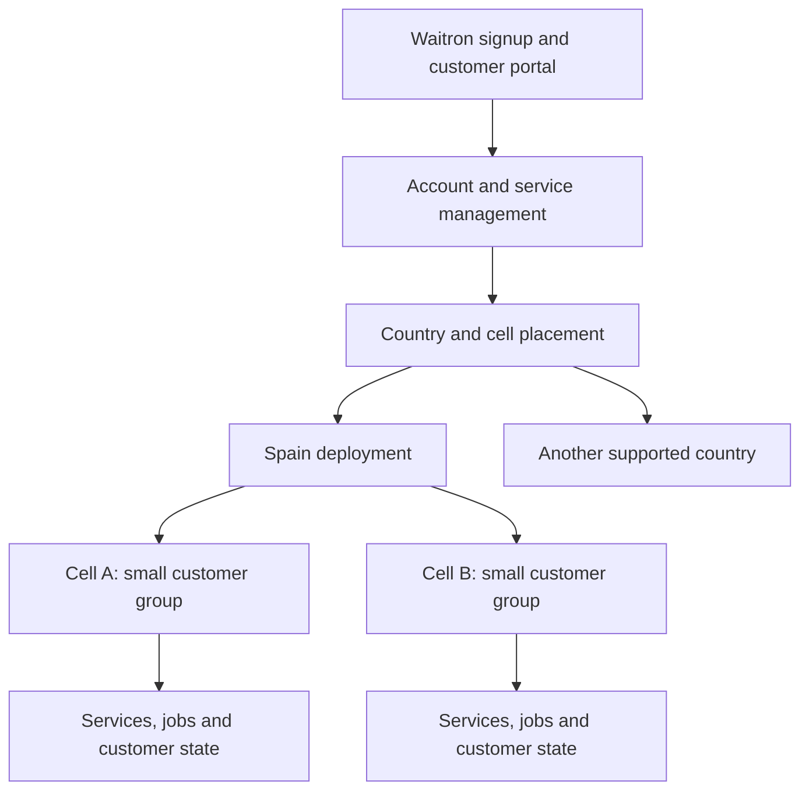

# Waitron Cloud: product and platform discussion

Status: brainstorm, 2026-09-22. The product requirements below come from the owner.
The platform structure and customer model are proposals for discussion. No service,
deployment architecture, pricing or implementation order has been approved.

## The product

Waitron Cloud is a commercial, closed-source product. You can subscribe from your
existing Waitron installation to services that connect, protect and extend your venue.
You can also run Waitron itself in the cloud. A business with several venues can
manage them centrally.

The owner wants customers divided into small deployment groups, called mini-zones,
across multiple availability zones. This should let operators upgrade a small group,
contain failures and move groups between hosts. The proposed residency policy is to
keep each country's customer data in that country. AWS and Google Cloud are deployment
targets to design for; the first provider and launch countries remain undecided.

These are product requirements and proposed policies. They are not claims that every
country imposes the same legal storage obligation.

## Services a venue can buy

This is a catalogue of candidates, not a build order or a set of subscription plans.
The complete earlier inventory is in the [service inventory](reference/2026-08-29-cloud-services-inventory.md).

| Service family | What you get |
| --- | --- |
| Remote access | Reach the venue's dashboard and public pages from outside its network, with managed names and certificates. |
| Backup and recovery | Continuous SQLite backup through Litestream, retained snapshots, visible backup freshness and a tested restore procedure. |
| Cloud failover | Bring up a cloud primary after an on-prem primary fails, then return to the venue when appropriate. Promotion authority remains a design decision. |
| Hosted Waitron | Run a dedicated Waitron instance in the cloud, with local hardware integration where needed. |
| Bookings and ordering | Public table bookings, online ordering, digital menus and pay-at-table pages. |
| Fiscal archive | Retained invoices and associated records, export, and access granted by the owner to an advisor or tax authority such as AEAT. |
| Analytics and reporting | Search and analyse venue data, receive scheduled reports, and compare or aggregate several venues. Elasticsearch or a similar system is a candidate. |
| Multiple venues | Central visibility, catalogue and configuration distribution, and group management. |
| Messages and notifications | Administrative emails, receipts, booking messages and mobile notifications, with preferences and delivery status. |
| Monitoring and upgrades | Venue health, alerts, version visibility and controlled automatic upgrades. |
| Further candidates | Loyalty and gift cards, opening-hours publishing, delivery and accounting integrations, forecasting, benchmarking and managed device enrolment. |

The older inventory also records excluded or conditional ideas. Hardware fulfilment,
operating mailboxes and a booking marketplace should not silently become commitments
through this list. Pricing, support scope and operating costs need their own decisions.

## Proposed customer and identity model

Start with a business account that subscribes and pays, people who belong to it, and
venues to which those people have permissions. Keep the business account distinct
from each taxpayer's legal identity, each venue, and the machines running that venue.
One account may eventually span several taxpayers and countries; that is still open.

A person could manage several businesses, and a business could give an accountant,
manager or support operator different access to different venues. A cloud account,
a local staff identity and a box's machine credential need explicit relationships.
Matching email addresses alone must not grant access to a venue.

Waitron's identity module is the starting point for reuse. Its
[package manifest](https://github.com/clintongormley/waitron/blob/830cf71fe854c7aa0b0d8c95078d3fe49ca05a10/packages/identity/package.json)
depends on Waitron's database, shared code and sync-enrolment packages. Its
[public interface](https://github.com/clintongormley/waitron/blob/830cf71fe854c7aa0b0d8c95078d3fe49ca05a10/packages/identity/src/index.ts)
includes invitations, management sessions, password recovery, passkeys and MFA.
Those are useful foundations to copy or extract with their behavioural tests. Cloud
organisations, memberships and cross-venue permissions need their own model. Choose
how shared security fixes reach both repositories before creating a permanent fork.

## Proposed country and mini-zone structure

Use a mini-zone, or **cell**, as the independently operated home of a bounded group
of customers. AWS uses the term [cell](https://docs.aws.amazon.com/wellarchitected/latest/reducing-scope-of-impact-with-cell-based-architecture/what-is-a-cell-based-architecture.html)
for this isolation pattern. Country placement, provider choice and cell assignment
are separate decisions.

Each cell would carry its provider, region, allowed country, availability-zone layout,
capacity and software versions. Its customers would keep stable identities and public
addresses when their placement changes. The migration procedure must move state and
queued work, preserve access rules, and prove completion before retiring the source.

An availability zone is an infrastructure location. A cell is our deployment and
failure boundary. We still need to choose whether a cell spans zones or runs in one
zone with recovery capacity elsewhere. Merely placing different customers in different
zones does not define how an affected customer's service recovers.

The intended isolation needs to cover application state, queues, resource limits,
credentials and rollout operations. A shared mutable database, gateway or analytics
cluster could widen a failure beyond one cell. Record every shared dependency and
decide its acceptable scope instead of claiming that cells isolate all failures.

The management layer should handle signup, subscriptions, provisioning and movement.
Running services should have enough local configuration and authority to continue
during a management outage; the exact authentication and revocation policy is open.
On-prem trading must retain its existing independence from cloud add-ons. A venue
whose primary is hosted in the cloud has a different availability dependency.

Residency covers more than the primary database: replicas, snapshots, archives,
analytics, logs, keys and notification contents all need a placement policy. Decide
where account and billing data live and how international group reporting works.
Failover and migration must honour that policy. A country without an acceptable
provider location needs an explicit product decision.

## Platform capabilities behind those services

These responsibilities need owners and interfaces. The table is not a requirement
to deploy a separate process for every row. Start with clear modules and deploy
service groups independently where their workload or failure boundary warrants it.

| Capability | Responsibility |
| --- | --- |
| Accounts and access | People, organisations, venue membership, roles, invitations, recovery and support access. |
| Commercial lifecycle | Service catalogue, subscriptions, billing, trials, usage limits, cancellation and the record of which services a customer may use. |
| Venue and node registry | Prove which account owns a venue and which machines act for it; enrol, replace, revoke and rotate credentials. |
| Placement and provisioning | Create resources, allocate cells, track capacity and finish or undo interrupted operations without creating duplicates. |
| Work execution | Durable background jobs, retries, schedules and progress for backups, restores, messages, reports and upgrades. |
| Connectivity | Names, certificates, routing, tunnels and customer isolation. |
| Data lifecycle | Retention, restoration, export, deletion, encryption and audit of privileged access. |
| Operations | Health, customer-visible incidents, resource and spend limits, release waves, pause controls and recovery procedures. |
| Waitron integration | Versioned APIs, signup and status screens, local credentials, configuration delivery and compatibility across installed versions. |

Cloud infrastructure, cloud application services and customer Waitron installations
are three upgrade targets. Each needs staged rollout and recovery rules. A release
that changes stored data may require more than restarting the previous image.

## Deployment on AWS and Google Cloud

Describe the capability in product code and put provider SDKs and resource identifiers
behind a small integration layer. Provisioning will still need provider-specific
implementations. Initial interpretation: a cell can run on either provider. Active
operation or automatic failover across providers is a separate, unresolved requirement.

| Capability | AWS candidate | Google Cloud deployment candidate |
| --- | --- | --- |
| Object storage | S3 | Cloud Storage |
| Compute | EC2, with the workload packaging still to choose | Compute Engine, with the same workload packaging goal |
| Administrative email | SES where its location and policies fit | An approved email provider through the same email interface |
| Mobile notifications | SNS with the selected mobile delivery service | FCM or another delivery service appropriate to the client |
| Jobs, secrets and monitoring | Choose services against required behaviour | Choose services against the same required behaviour |

These are candidates, not interchangeable API promises. Litestream documents
[Google Cloud Storage replication and restore](https://litestream.io/guides/gcs/),
which supports investigating both storage providers. It does not verify Waitron's
promotion protocol: conditional writes, credentials, retention and restoration still
need experiments against each supported store. The inherited prototype used MinIO.

Google documents [Compute Engine instances](https://docs.cloud.google.com/compute/docs/instances)
and [external email delivery options](https://docs.cloud.google.com/compute/docs/tutorials/sending-mail).
[SNS mobile push](https://docs.aws.amazon.com/sns/latest/dg/sns-mobile-application-as-subscriber.html)
uses delivery services such as APNs and FCM; [FCM](https://firebase.google.com/docs/cloud-messaging)
also supports web clients. First decide whether notifications mean native apps,
browser push, SMS or several of these.

Provider service coverage must be checked country by country. For example, the
[SES endpoint list](https://docs.aws.amazon.com/general/latest/gr/ses.html) checked on
2026-09-22 does not list Spain. Keep the location of email processing as an explicit
decision rather than assuming every service shares the compute region. These are
documentation checks, not deployment tests or a legal assessment.

## Signup from Waitron

Proposed journey:

1. Open Cloud services in the venue's Waitron dashboard.
2. Create or sign into a cloud account and prove authority to connect this venue.
3. Choose services and see the country, terms and price before subscribing.
4. Cloud provisions the resources and returns a status the dashboard can follow.
5. The box receives credentials scoped to its services and starts using them.
6. The owner can manage, cancel or change services and export data through a clear lifecycle.

Payment success, account creation and resource provisioning can finish at different
times. Model those states explicitly so retrying signup cannot charge twice or leave
an unusable subscription. Decide how an owner manages recovery when the box itself
is unavailable; the cloud portal is the proposed independent entry point.

## Questions for the next discussion

- Can one business account own venues and taxpayers in several countries? Which data
  may its shared identity and cross-country reporting layer hold?
- Is the venue the smallest placement unit, and should a business's venues share a
  cell or be spread across cells?
- What availability promise does each service make? How much recent data can recovery
  lose, how long may it take, and who authorises promotion?
- Which country and provider launch first? What evidence is needed before the second
  provider is called supported?
- Are services purchased individually, in bundles, or both? What happens to retained
  data and access after cancellation or failed payment?
- How are independently deployed service groups arranged inside cells, and which
  shared dependencies are acceptable?
- Which remote-access model replaces or retains the older per-venue endpoint decision?
  The [shared gateway handoff](reference/2026-09-21-cloud-ingress-wireguard-gateway-design.md)
  and [earlier decision](reference/2026-09-05-relay-decision.md) are not reconciled.

Use the [backlog](backlog.md) to track these decisions and the eventual implementation
slices. No first service has been selected by this brainstorm.
