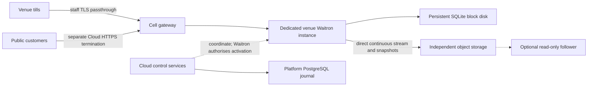

# Run a venue in Cloud, or recover its local server there

**D88 · 2026-10-21 · PROPOSED for owner approval. Nothing in this proposal authorises a build or deployment.**

You should be able to start a new venue with its main Waitron server in Cloud, or recover there after its local servers fail. Cloud supplies the place to run it, storage, connectivity and recovery coordination. Waitron decides whether a server may write sales or file fiscal records. **Promotion** enables a standby as the active writer; restoring a database does not confer that authority.

## Start with the evening you need to recover

Your venue closes with both local boxes failed. The till still has internet. You can recover from the last usable offsite copy, but changes that never left the boxes are unavailable until their disks return. A Cloud follower could already hold a restored copy; a cold recovery first needs capacity, startup and restore. Either path must establish that both boxes are out of service and cannot be promoted separately before Cloud writes.

**First owner question, for the driver to ask on its own:** in that evening, would you accept waiting for Cloud startup and restore, or pay continuously for a running follower to reduce that part of the wait, with the same fencing and activation checks in either case?

Recommend keeping cold recovery as the initial cost baseline, and adding a running follower if measured recovery cannot meet the target you adopt. This chooses a recovery shape, not a recovery-time promise. Neither startup capacity nor total recovery time is measured. Waitron's fiscal preparation can add waiting of its own; paying for a follower does not remove it.

## What the sources establish

This draft uses Cloud baseline `6519293714542017fe928e6004db9523b088db69`. The [ownership map](../../documentation-ownership.md), [product discussion](../../product-and-platform.md), [launch boundary](../../launch-evidence.md), [integration contract](../../waitron-integration-contract.md), [remote-access proof](../../local-remote-access.md) and [backup proof](../../local-backups.md) supply requirements and recorded evidence. They do not establish deployed hosting or safe production activation. Existing local recovery receipts explicitly record activation as not performed. No runtime proof was run for this draft.

Waitron's [canonical topology](https://github.com/clintongormley/waitron/blob/main/docs/superpowers/specs/2026-09-16-sqlite-litestream-topology-design.md), sections 3–7, was inspected locally at clean main `d1279671e8c5d352eb07892e148bd2b5eefe2e4f`. Its cold-recovery mechanism remains useful; its reserved seats and old fiscal allocation rules do not govern this proposal.

The counterpart is the **UNAPPROVED** [A947 design](https://github.com/clintongormley/waitron/blob/490ece84c7e2e0f0185c0029d8c53a768e4f3fe2/docs/superpowers/specs/2026-10-21-a947-two-box-failover-design.md), especially sections 2, 6, 7 and 10. Its documentation is published at Waitron commit `490ece84c7e2e0f0185c0029d8c53a768e4f3fe2`; publication does not approve its design or this contract. The published file matches the inspected draft byte for byte (SHA-256 `044cbc43de8fa39d3df2f7236572b92c007eff7854ed048b6f218201112471a1`). Reconcile later changes before agreement.

A947 reports A679's hour-coded series as superseding the old seat-number allocation. A standby stays dormant without a reserved hour or series. Waitron selects an hour at activation. Its latest draft reports one current installation code for recovery, superseding the earlier list, and leaves dormant-promotion preparation unresolved. Cloud must not mint seats, select hours, allocate series or invoice numbers, create chains, or supply fiscal activation authority. Older registry endpoints and historical restore-hook descriptions in Cloud are not a hosting authority. Waitron owns the exact fiscal preparation, authentication, clock checks, identity changes and any mandatory wait.

## Give each venue its own operational instance

An operational instance means an isolated Waitron process or container with its own configuration, machine identity, disk and resource budget. It does not necessarily mean a whole virtual machine. Recommend evaluating several isolated venue containers on shared hosts because each venue still has one separately managed application and SQLite file, while spare host capacity can be shared. This is a proposal pending security approval and capacity evidence.

A dedicated virtual machine per venue is expected to give a stronger host boundary and simpler attribution, at the cost of an idle machine floor for each venue. That security tradeoff needs review. Shared containers share the kernel, the host operating system's core, and host failure. Do not accept a namespace alone as isolation evidence. Do not select a venue count per host until representative sales, filing, backup, restore and neighbour-overload measurements pass. Keep dedicated machines available if the approved security boundary requires them.

Spain on AWS Europe (Spain), `eu-south-2`, is the existing product/provider candidate. It is not a new promise that every supplier, support path or metadata flow stays in Spain. Place each venue independently in an approved country and a **cell**, a bounded group operated and recovered together. An organisation can span cells. Record the cell's provider, region, zone layout, permitted data classes, capacity and release versions. Other countries and providers need separate approval and evidence.

Use the established Kubernetes direction for scheduling and staged operations, with provider adapters underneath. A **StatefulSet** is Kubernetes' controller for workloads with stable identities and persistent storage. A one-instance StatefulSet is a packaging candidate, not permission to restart a second writer. Cluster sharing across cells, the service choice, zone layout and recovery reserve remain deployment decisions. Shared cluster, account, identity, PostgreSQL and secrets dependencies must be named in the cell failure map.

Keep persistent single-writer SQLite on a venue-owned block disk, separate from disposable container files. Include SQLite journal files, Waitron's node-local state, configuration and required module state in the persistence inventory. Do not share a writable database between application replicas. Waitron's single-process folder guards and filesystem behaviour need qualification on the selected disk and container image.

Cloud's platform PostgreSQL stores accounts, installations, placement, jobs and operation history. It does not replace venue SQLite. Gateways, account services, workers and backup storage must not live on or depend on a venue disk. Replacing a tenant workload must not replace its neighbours' services or erase its backups. A platform outage must not immediately stop established service; signed configuration and scoped credentials retain their existing expiry and revocation limits. Record those limits rather than promising indefinite operation without control services.

Bound CPU, memory, process count, scratch, disk growth, disk operations, network traffic and job concurrency per venue. Reserve restore and verification capacity separately so a recovery cannot exhaust trading capacity. Apply private network rules, separate service identities, restricted disk attachment and default refusal of cross-venue access. Deny host privilege and access to other workloads' secrets. Define an explicit pause/escalation policy before a quota threatens data integrity; never delete fiscal records to relieve pressure.

Workers receive only the capability needed for one operation and venue: capture writes, follower reads, restore reads, verification or lifecycle work. A follower cannot alter the source store. No tenant process receives platform database administration, cluster administration, another venue's disk, or broad storage/deletion credentials. Credential delivery, expiry, rotation, support access and issuer compromise need deployment tests, including revocation during a running operation.

## Provision once, recover uncertain work

Record a durable operation journal in platform PostgreSQL before requesting resources. Bind an operation to its actor, venue, requested mode, placement revision, image digest and input fingerprint. An **idempotent** retry repeats the same intended action without creating another instance, disk or installation. The same identifier with changed input is a conflict. Serialize competing lifecycle operations for a venue and reject stale worker completions with a claim version.

The conceptual sequence is reserve capacity, allocate disk and Cloud installation identity, deliver scoped secrets, prepare Waitron in a non-writing mode, verify readiness, obtain the Waitron activation result, then publish routes. These are proposed operations, not implemented endpoints. Persist intent before each outside call and its observed outcome afterward. A lost reply means uncertainty: inspect the existing resource and Waitron operation before retrying. Never infer activation failure from a timeout.

Before activation, cancellation can remove only resources proved to belong to that operation, retaining diagnostics without secrets. After possible activation or writes, preserve the disk, journal and generation and reconcile authority. Cleanup must never destroy the only recoverable ledger. A crash after allocation resumes that allocation; a crash after activation recovers its receipt rather than starting another activation. Distinguish provisioned, restored, verified, awaiting fence, activation uncertain, active and routed in status.

For a new Cloud-primary venue, there is no predecessor to fence or recovery point to import. Still prove that this is a new venue, bind its Cloud installation to the Waitron-created venue/node, and obtain Waitron's normal initial setup and activation result. Cloud account permission to buy hosting does not bypass local administrator or fiscal setup requirements. The bootstrap exchange for a venue with no existing box is a joint prerequisite, not an assumed reuse of box pairing.

## Recover without creating two writers

**Fencing** means establishing that the previous workload cannot sell, mutate its ledger or file records, including while isolated from the control plane. Prove it stopped before allowing a new writer. Removing a Kubernetes object, losing a heartbeat, withdrawing a gateway route, revoking Cloud credentials or seeing a disk attached elsewhere does not prove that an isolated old primary cannot write or file. A StatefulSet's desired replica count is not that proof.

The exact evidence for planned quiescence, meaning stopped writes and settled in-flight work, host power isolation, restart prevention and physical box shutdown must be agreed with Waitron and the selected infrastructure. Bind it to the old workload, host/boot identity, operation and membership revision, not just a name that can be reused. A planned stop must block sales and new filing, settle or record outstanding external requests under Waitron's rules, flush the final stream state and prove the target has that state. Unknown stop evidence remains **blocked**, including for a Cloud-to-Cloud replacement. No unsafe automatic failover is proposed.

| Situation | Proposed recovery shape | Boundary that remains |
| --- | --- | --- |
| One local box fails | Cold Cloud recovery from its stream, or an approved running follower | Establish that the box is stopped; expose actual recoverable time and unavailable tail. |
| Both local boxes fail | Recover the copied-up offsite stream or independent snapshot | Enumerate both boxes and every other promotable peer; copy-up may lag the local follower. |
| Cloud host fails | Fence the old workload, then reuse its disk in the same zone if suitable, or restore onto a new disk | Host failure is not proof of stop. No speculative writer restart while isolation is uncertain. |
| Cloud-primary venue loses internet | Tills lose their primary unless a separately approved local follower can be safely promoted | A mobile-data till or second uplink may still reach Cloud; internet loss is not a Cloud fence. |

The September topology sections 4.1 and 4.3 use **cold recovery**: the stream is stored offsite but no standby application runs. A failure starts a new instance and restores it. Its statement that this prevents split brain by construction needs the explicit stop proof above; scheduling one desired instance cannot establish what an isolated host is doing.

A947 section 10 instead proposes a **running follower**, continuously restoring a local read-only database in Cloud. It saves some startup/restore work but adds continuous runtime, disk, key access and freshness monitoring. It must never sell, file, print or run business workers before activation. Stopping follow mode and verifying the copied state remain Waitron work. This difference needs owner choice and bilateral agreement; it is not settled by either document's existence. Neither shape justifies a seconds-long recovery claim.

For one local box, its stream can go directly to Cloud. For two boxes, A947 proposes main-box stream to the local spare's store, then deletion-aware copy-up to Cloud. Its local spare and Cloud follower have different progress positions. A **generation** is a separately named stream history opened for a writer and authority term. Preserve generation ownership and never move a copied pointer backward. Do not assume two destinations from one Litestream writer; A947's inspected pin permits one. Waitron must qualify copy-up and direct-stream restoration equivalence before Cloud relies on the two-box path.

An optional on-site follower for a Cloud primary can keep an already received copy during an outage, but cannot receive missing Cloud writes without a connection. Local offline writes require a separately approved promotion protocol that fences Cloud and excludes every other candidate. Distinct fiscal identities do not preserve divergent open bills, kitchen work or payment outcomes. Do not promise offline trading or automatic state merging. An old writer's return stays fenced before sales and the first filing pass, with Waitron owning tail reconciliation, its acceptance receipt, guarded wipe and fresh dormant identity. A947's tail proof and activation preparation are dependencies, not completed Cloud features.

AWS EBS disk attachment stays within its Availability Zone, a provider infrastructure location. A cross-zone recovery creates a new disk from a qualified restore source; it cannot reattach the old disk across zones. Reserve and test capacity for the chosen recovery location without crossing the approved country boundary. Disk snapshots alone are not proof of a complete, application-consistent Waitron restore.

## Agree one shared contract before building

The proposed joint contract home is the **[hosted lifecycle and promotion section](../../waitron-integration-contract.md#hosted-lifecycle-and-promotion-proposed) of Cloud's integration contract**. This design records its required contents, not an approved wire format. Waitron's canonical topology and A947 section 10 must link to that same home when both owners accept a pinned revision. No bilateral acceptance has occurred in this drafting task; do not edit or imply approval from the other lane.

| Contract boundary | Required agreement and evidence |
| --- | --- |
| Identity and trust | Map Cloud venue/installation and fresh machine credentials to Waitron venue/node identities for initial setup, follower, restore and replacement. Never equate Cloud replacement with a fiscal identity allocation. Separate membership signing, machine authentication and any Cloud endorsement capability. |
| Store layout and versions | Pin exact wire/manifest versions, capabilities and compatibility refusals; reconcile `venues/<venue-id>/`, generation names such as `gen-<term>-<node>-<time>`, create-only markers, signed `current.json`, signing purpose/canonical bytes and trusted keys. Agree the meaning of Cloud versus Waitron venue ids in prefixes. |
| Concurrency and authority | Specify compare-and-swap (CAS), a write accepted only if the prior object version still matches, for the pointer. Reconcile pointer publication with Waitron's activation transaction, membership authority, losing contenders and crash recovery. PostgreSQL plus an object store plus local SQLite is not one atomic transaction. CAS alone does not fence an existing writer. |
| Follower and progress | Enforce source-store read-only credentials and no business workers. Report source head, uploaded head, copied-up head, follower-applied head, observation times, source identity and generation. Stale or missing evidence is unknown, not healthy; backup observation time is not a guarantee of zero data loss. |
| Fence and activation | Enumerate all promotable peers, including both local boxes and any Cloud/on-site follower. Bind accepted stop evidence, recovery point and operator confirmations to that set. Require a verifiable Waitron activation receipt with operation, target, membership/authority revision and outcome before routing. Exact receipt format and stop proofs are joint prerequisites. Backup verification is never this receipt. |
| Intent, outcome and retry | Define durable intent, success, refusal and uncertainty on both sides; input fingerprints, concurrency refusal, status lookup, receipt verification and exact retry after lost replies. Reject unsupported versions before side effects. Keep stable names, but move routes only after confirmed activation and target probes. |
| Return and secrets | Waitron owns frozen-tail transfer and acceptance, external-result reconciliation and fresh identity preparation; Cloud coordinates disk preservation, fresh service credentials and placement. Pin required node-local state and key versions, external-vault compatibility, rotation and recovery when the source is lost. |

Bilateral design acceptance records both repository revisions, named owners and shared refusal/retry vectors, and defines the runtime acceptance cases before adapters are built. Runtime qualification requires real pinned-consumer receipts for the selected service shape. A Cloud-primary-only launch qualifies new venue setup, Cloud host replacement, upgrades, devices and backups; it does not wait for optional local followers or box takeover. One-box recovery additionally qualifies uncertain activation and old-node return; two-box recovery adds both peers and copy-up. A running follower qualifies the shared recovery checks plus its own non-writing and catch-up checks. No unqualified shape may be offered. Reconcile A947, A679 dormant-promotion preparation, W41s activation, signed-witness/fencing work W41s-10b and non-activating verification A850 at their actual landing revisions. Design acceptance does not satisfy a runtime gate; a draft or queued item is not an implemented dependency.

## Upgrade the application without rolling back its ledger

Pin each Waitron image by digest, record its schema and contract versions, and roll through a small approved cell cohort with a pause control. Block overlapping restore, move and upgrade operations. Stop writes and filing through Waitron's quiescence contract, settle outstanding device/provider work, capture a final recovery point and verify compatibility before migration. Keep old disk state protected while the candidate is checked without business workers.

Restarting the previous image is permitted only when Waitron proves schema compatibility and no irreversible migration, activation or new writes occurred. Once writes occur or a new generation is opened, **do not roll back the ledger, reuse the old generation or resume a retired identity**. Repair forward or take the approved replacement/recovery path with Waitron's fresh activation rules. An older snapshot is for isolated inspection or explicit fresh recovery, never an in-place undo. Record uncertain external outcomes rather than retrying payments or fiscal submissions blindly.

## Keep backups and their keys outside the workload

Stream directly to independently provisioned object storage and retain separately recoverable encrypted snapshots. Losing a gateway, host, cell runtime or tenant disk must leave the recovery path available through the independent portal. Separate object scopes and deletion authority so losing the stream does not delete snapshots. A snapshot restores to its own capture time; do not fast-forward an archive with unrelated stream files.

The adopted starting policy is daily snapshots for 30 days and monthly snapshots for 12 months, plus protection of the last verified snapshot while subscribed. Longer selected retention is a paid-policy candidate. Scheduling detail, cancellation, explicit deletion, export and exit remain launch decisions. Continuous hourly snapshots with 30-day retention are Cloud's existing working proposal; inspected Waitron `packages/stream/src/litestream.ts:78` instead emits `interval: 24h` and `retention: 168h`. Reconcile and measure that conflict, rather than asking the owner to choose an already adopted snapshot policy again.

Verification must restore the exact artifact in isolation without activation, filing, payment calls or customer messages, and record digest/generation, formats, verifier version, keys and outcome. A850's non-activating path and Cloud qualification must be pinned before admitting affected backups. Existing local receipts used then-current restore hooks; they do not qualify a later fiscal contract. Failed verification keeps the protected older copy and shows stale health.

Keep backup decryption, application vault access, installation credentials, membership keys and staff TLS private keys separate. Cloud-managed recovery must work without the original server or an owner-saved backup key, preserving required old key versions. Customer-managed archives keep owner-held custody. Staff TLS keys belong to the endpoint, even when hosted; access still follows approved support controls. A hosted external vault requires the integration contract's `external-vault-archive-v2` dependency before capture/restore can omit a bundled vault key. A947's proposed on-site shared credential ring is not approval of Cloud custody. Test lost-server recovery and key rotation before retirement of any retained key dependency.

## Reach Cloud and the devices in your venue

Tills reach the stable staff TLS hostname through the cell's passthrough gateway; TLS ends at that venue's Waitron instance. Public customer traffic uses a separate hostname with Cloud termination and an encrypted onward connection. Preserve hostname, cookie, route and permission separation, certificate renewal and refusal of direct bypass. Routes carry only confirmed active authority, not merely a restored database. A hosted primary makes trading dependent on internet and the Cloud path; local DNS cannot manufacture an offline server.

Printers, drawers and payment terminals stay local. Use a Waitron-owned authenticated outbound agent contract, never public raw printer/payment ports. The contract must identify venue, device, active server and command, persist acknowledgements, distinguish accepted from physically completed work, bound retries, and suppress duplicate effects with stable command identifiers. A timeout leaves an uncertain payment or print outcome, not permission to repeat it. Rehearse lost acknowledgements, restarts, failover, reconnect and stale-server refusal on the actual device path. USB devices die with their agent host unless moved; Cloud hosting alone cannot solve that. A947's print routing and A764 payment-ownership decisions need joint proof before offering complete hosted trading.

## Cost a venue without inventing a bill

D68 is an unpublished sibling at supplied signed commit `4b7c515a718d9404a8ccce14b5ff493c78365e16`; its observed HEAD matched and its status was clean. Only its public `docs/cloud-cost-model.md`, `docs/cost-model/inventory.json` and `docs/cost-model/prices.json` were used from `/Users/clintongormley/workspace/worktrees/cloud-feat-cloud-cost-model/`. No private venue sources were opened. Inventory explicitly excludes `hosted-waitron` and `cloud-failover`, and marks complete totals unavailable. Prices are stored USD list receipts read on 2026-10-14, not a current quote or measured provider bill.

For a chosen month and service shape, use **venue cost = marginal runtime + allocated disk/performance + keys + backup/verification/recovery + traffic + attributed operations + share of fixed cell/platform floor**. Marginal means the extra consumption attributable to that venue. An equal-share accounting scenario allocates platform floor `Fp/N` across `N` venues and cell floor `Fc/Nc` across that cell's `Nc` venues; a different allocation must be explicit. With zero venues the floor remains a platform cost, not a division by zero. Distinguish this allocation from the cash increase when another host or cell is needed.

| Cost term | Quantity and evidence still needed |
| --- | --- |
| Runtime | Hosted primary: all running hours and measured CPU/RAM. Cold standby: no continuously running venue follower, but expected recovery/test hours and any reserved spare capacity. Running follower: continuous follow hours plus promotion/test work. Primary and follower are separate allocations. |
| Disk | Provisioned block-disk size, journal/growth headroom, node state, restore scratch, follower disk, performance and any disk snapshots; a small database does not establish a safe disk size. |
| Keys | Active per-venue keys, retained/rotated versions, secret storage and measured requests. Do not invent one KMS request per SSE-C upload or duplicate keys already included in backups. |
| Backups and recovery | Stream and retained-object byte lifetimes, versions, unfinished uploads, requests/retries, verifier CPU/RAM/scratch, restore frequency and key access. Reconcile hourly/30-day versus daily/seven-day stream policy before projection. |
| Traffic | Directional staff/public/device, stream, follower, restore, image and cross-zone bytes, protocol overhead, paid endpoints and egress path. Count each charged direction once; unknown public traffic is not zero. |
| Fixed floor and operations | Platform PostgreSQL/recovery, control services, gateways, Kubernetes control plane if selected, spare host capacity, DNS, images, networking, monitoring, audit, support and incident work. Add each venue's variable operations separately. |

For shared hosts, an initial capacity bound is the minimum of CPU, RAM, disk-attachment and measured disk/traffic/concurrency limits after platform and recovery reserves. If that bound is `K`, `ceil(N/K)` hosts are required for `N` hosted venues before additional failure reserves. `K` is unknown. Charge the host pool once, then allocate it across venues; do not charge a full virtual machine per container and add the same pool again. Failure recovery can require several venues at once, so average idle headroom is not a reserve proof.

D68's scoped example contains 207 selected sales, a 19,546,112-byte copied source database, 700,416 bytes of fresh-venue growth and a separate 3,527,677-byte selected-sale archive. These are different measured quantities from one local scenario, not typical venues, allocated disk sizes, AWS throughput or evidence that archive size stays constant. Repeating them by day or sale is an explicit assumption, not another measurement.

A narrow arithmetic example is possible: D68 `prices.json` record `ec2-t3-small` in `eu-south-2` is USD 0.0228 per Linux instance-hour. **Assuming one whole instance runs for 730 hours, compute alone is USD 16.644 for that model month.** This is neither a recommended size nor a per-venue total. It excludes CPU credits, disk, IPv4, keys, backup, traffic, shared platform and operating costs; shared-host allocation needs measured `K`. A continuously running follower adds its own qualified allocation; cold recovery still has storage and reserved/on-demand recovery costs. No complete hosted subtotal or EUR monthly total is established. Gross rates exclude discounts, allowances, credits, tax and foreign exchange; account-wide allowances cannot be repeated per venue.

Before pricing, extend D68's scope with representative hosted workloads and concurrent restores, selected disk/key/network configurations, dated quantities and billing rules, operational reserve and an authorised provider bill comparison. D68's synthetic trial stopped before provisioning. Its earlier remote-access/backup subtotals cannot price this new service, and unpublished artifacts must not be described as landed launch evidence.

## Failures must leave evidence, not a second primary

| Failure or uncertainty | Required behaviour | Evidence gate before launch |
| --- | --- | --- |
| Host/control partition or forced pod deletion | Block another writer until the accepted stop proof exists; preserve disk and journal. | Isolate a still-running old primary and show no replacement writes or filing without proof. |
| Two promoters or lost activation reply | Retain one intent; reconcile Waitron outcome and pointer/membership state; do not activate again blindly. | Concurrent promotion and crashes around local commit, CAS and receipt delivery on both pinned consumers. |
| Stale two-box copy-up or returning old box | Show recoverable time and every peer; keep return fenced before workers; preserve its tail. | Lag, interrupted copy-up, missing final writes and return with stale membership, including internet isolation. |
| Disk or zone loss | Restore a qualified source onto a new disk when needed, after old-writer fencing. | Same-zone restart and cross-zone restore with measured capacity, loss window and final activation. |
| Provision/upgrade worker crashes | Resume the recorded intent; reject stale completion; preserve any possibly written ledger. | Lost allocation replies, duplicate workers, migration failures and crash after first new write/generation. |
| Stream loss, wrong key or failed snapshot | Use only a qualified fallback; retain the protected copy and key dependencies. | Restore with stream absent, older keys, source absent, failed verifier and interrupted cleanup; no fiscal activation by verification. |
| Gateway, management or neighbour overload | Keep backups independent; show separate stale/failed states and enforce resource isolation. | Gateway-absent recovery, management outage/expiry, abusive neighbour and concurrent restore without cross-venue authority. |
| Device acknowledgement lost during takeover | Reconcile the persisted command outcome; refuse duplicate effects and stale-server commands. | Actual printer/payment-agent restart and retry proof, not only successful HTTP delivery. |

Current code inspection is narrower than these gates: Cloud `packages/backups/src/managed-streams.ts:234` verifies signed pointers; `packages/backups/src/replacement.ts:27` restricts recovery to test venues and `:89` coordinates owner-confirmed Cloud registration/placement replacement. Those operations do not prove a stopped writer. Waitron A947-tree `apps/server/src/promote.ts:58` checks a fence attestation and `:169` invokes Waitron-owned module activation. These paths were read, not run; their existence does not establish this proposed lifecycle.

The driver checked the official [StatefulSet](https://kubernetes.io/docs/concepts/workloads/controllers/statefulset/) and [persistent-volume](https://kubernetes.io/docs/concepts/storage/persistent-volumes/) documentation on 2026-10-21: orchestration/storage objects do not supply application fencing proof. The supplied [EBS documentation](https://docs.aws.amazon.com/ebs/latest/userguide/ebs-volumes.html) establishes same-zone attachment. Other deployment capability, capacity and isolation statements above are proposed requirements or explicitly unverified assumptions until the selected configuration passes the [launch gate](../../launch-evidence.md#pass-the-production-evidence-gate).

## Decisions to take after the first worked example

Keep these as the driver's ordered decision list, not simultaneous questions. Confirm the permitted data locations and vendor/subprocessor chain, including backups, logs, keys, support and global control metadata. Set tolerated data loss, recovery time and who may promote each service shape only after seeing its evidence. Set cancellation, retention extensions, export and exit handling while preserving the adopted daily/monthly starting policy. Agree key custody, time-limited approved support and emergency authority. Then choose packages and prices using a completed scoped cost model. The shared-host security boundary and actual bilateral contract acceptance are prerequisites alongside owner approval. The [conditional delivery outline](../plans/2026-10-21-cloud-hosted-venue-design.md) keeps every build slice behind those gates.
