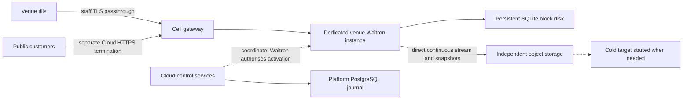

# Run a venue in Cloud, or recover its local server there

**D88 · 2026-10-21 · PROPOSED for owner approval. Nothing in this proposal authorises a build or deployment.**

This documentation extends published #265 with the owner's local-device and public
customer access scope. It comes with the **Cloud step soon after go-live**, not
go-live. Publication is not owner design approval; implementation and provider work
remain blocked. The owner selected cold recovery on 2026-10-21. The
[D101 data-protection design](2026-10-22-cloud-data-protection-design.md) was approved
on 2026-10-22 around 08:30 for build planning only, including its D88 data-protection
direction. Its [roadmap](../plans/2026-10-22-cloud-data-protection.md) records the reviewed
documentation milestone; implementation requires separate build authority. Broader D88 hosting/isolation/shared contracts
and existing recovery/fiscal gates remain separate and open.

**2026-10-23 handover revision:** the [A1018 shared direction](../../waitron-integration-contract.md#handover-between-local-and-hosted-machines-a1018)
replaces this draft's external stop-proof requirement. Cloud agrees the direction.
The owner’s 15:37 correction makes M2 solely responsible for AEAT after either
takeover, including returned M1 originals and outcomes; M1 never contacts AEAT.
Waitron asks one short revised owner design question. Retained defaults, build and
runtime acceptance remain pending. The owner approved gVisor and Spain running
from Paris on 2026-10-23; those choices do not grant provider or activation authority.

You should be able to start a new venue with its main Waitron server in Cloud, or recover there after its local servers fail. Cloud supplies the place to run it, storage, connectivity and recovery coordination. Waitron decides whether a server may write sales or file fiscal records. **Promotion** enables a standby as the active writer; restoring a database does not confer that authority.

## Start with the evening you need to recover

Your venue closes with both local boxes failed. The till still has internet. The owner
selected **cold recovery**: start Cloud capacity and restore only when needed. You can
recover from the last usable offsite copy, but changes that never left the boxes are
unavailable until their disks return. Enumerate both boxes and every other
promotable peer. Use the explicitly selected recovery path and its shutdown and
sole-recovery declarations; no hard-stop proof is added to authorised cold restore.

This chooses a recovery shape, not a recovery-time promise. Startup capacity and total
recovery time remain unmeasured, and Waitron's fiscal preparation can add waiting.
A continuously running follower is a future, unapproved option, not the initial
service or a question to reopen. Reliability, packages and prices follow measurements.

## What the sources establish

This draft uses Cloud baseline `6519293714542017fe928e6004db9523b088db69`. The [ownership map](../../documentation-ownership.md), [product discussion](../../product-and-platform.md), [launch boundary](../../launch-evidence.md), [integration contract](../../waitron-integration-contract.md), [remote-access proof](../../local-remote-access.md) and [backup proof](../../local-backups.md) supply requirements and recorded evidence. They do not establish deployed hosting or safe production activation. Existing local recovery receipts explicitly record activation as not performed. No runtime proof was run for this draft. The 2026-10-22 D101 reconciliation inspects
Cloud base `60c0fbf25618a30977657fe74cce90fc5dbb915b`; its linked source references
distinguish existing components from proposed controls. D101 is documentation only.
D79 is parked unpublished at `fab41b1`; its verifier work and migration 043 are not
part of this base or hosting launch evidence.

Waitron's [canonical topology](https://github.com/clintongormley/waitron/blob/main/docs/superpowers/specs/2026-09-16-sqlite-litestream-topology-design.md), sections 3–7, was inspected locally at clean main `d1279671e8c5d352eb07892e148bd2b5eefe2e4f`. Its cold-recovery mechanism remains useful; its reserved seats and old fiscal allocation rules do not govern this proposal.

The counterpart is the **UNAPPROVED** [A947 design](https://github.com/clintongormley/waitron/blob/490ece84c7e2e0f0185c0029d8c53a768e4f3fe2/docs/superpowers/specs/2026-10-21-a947-two-box-failover-design.md), especially sections 2, 6, 7 and 10. Its documentation is published at Waitron commit `490ece84c7e2e0f0185c0029d8c53a768e4f3fe2`; publication does not approve its design or this contract. The published file matches the inspected draft byte for byte (SHA-256 `044cbc43de8fa39d3df2f7236572b92c007eff7854ed048b6f218201112471a1`). Reconcile later changes before agreement.

A947 reports A679's hour-coded series as superseding the old seat-number allocation. A standby stays dormant without a reserved hour or series. Waitron selects an hour at activation. Its latest draft reports one current installation code for recovery, superseding the earlier list, and leaves dormant-promotion preparation unresolved. Cloud must not mint seats, select hours, allocate series or invoice numbers, create chains, or supply fiscal activation authority. Older registry endpoints and historical restore-hook descriptions in Cloud are not a hosting authority. Waitron owns the exact fiscal preparation, authentication, clock checks, identity changes and any mandatory wait.

## Give each venue its own operational instance

An operational instance means an isolated Waitron process or container with its own configuration, machine identity, disk and resource budget. It does not necessarily mean a whole virtual machine. Recommend evaluating several isolated venue containers on shared hosts because each venue still has one separately managed application and SQLite file, while spare host capacity can be shared. The owner approved the gVisor sandbox choice on 2026-10-23; deployed isolation and capacity evidence remain unqualified.

A dedicated virtual machine per venue is expected to give a stronger host boundary and simpler attribution, at the cost of an idle machine floor for each venue. That security tradeoff needs review. Shared containers share the kernel, the host operating system's core, and host failure. Do not accept a namespace alone as isolation evidence. Do not select a venue count per host until representative sales, filing, backup, restore and neighbour-overload measurements pass. Keep dedicated machines available if the approved security boundary requires them.

The owner's country-pack policy names each country's home and permitted backup regions;
same-country hosting is not always possible. For Spain, venue data, logs and keys stay
in AWS Europe (Spain), `eu-south-2`, with **one extra backup copy in another EU region**.
D101 records approved Paris `eu-west-3`, subject to qualification, with Spain key dependencies and no automatic
venue activation during cross-region recovery. The approved production direction
allows Spain to run from Paris, subject to legal/provider and venue recovery gates. Menu translation remains disabled until D101’s
separate input-eligibility rule is accepted. Any later eligible menu text must be
minimised and contain no personal data; review/detection alone cannot establish that
for arbitrary strings.
D102's owner-selected SES email in an EU region is a separate exception. Neither
exception proves a Spain-only supplier chain or settles AI location/legal evidence.

Place each venue independently in its approved home region and a **cell**, a bounded
group operated and recovered together. An organisation can span cells. Record the
cell's provider, region, zone layout, permitted data classes, capacity and release
versions. Qualify each country/service against D101's supplier/transfer register;
unknown locations and supplier access remain launch gates.

Use the established Kubernetes direction for scheduling and staged operations, with provider adapters underneath. A **StatefulSet** is Kubernetes' controller for workloads with stable identities and persistent storage. A one-instance StatefulSet is a packaging candidate, not permission to restart a second writer. Cluster sharing across cells, the service choice, zone layout and recovery reserve remain deployment decisions. Shared cluster, account, identity, PostgreSQL and secrets dependencies must be named in the cell failure map.

Keep persistent single-writer SQLite on a venue-owned block disk, separate from disposable container files. Include SQLite journal files, Waitron's node-local state, configuration and required module state in the persistence inventory. Do not share a writable database between application replicas. Waitron's single-process folder guards and filesystem behaviour need qualification on the selected disk and container image.

Cloud's platform PostgreSQL stores accounts, installations, placement, jobs and operation history. It does not replace venue SQLite. Gateways, account services, workers and backup storage must not live on or depend on a venue disk. Replacing a tenant workload must not replace its neighbours' services or erase its backups. A platform outage must not immediately stop established service; signed configuration and scoped credentials retain their existing expiry and revocation limits. Record those limits rather than promising indefinite operation without control services.

Bound CPU, memory, process count, scratch, disk growth, disk operations, network traffic and job concurrency per venue. Reserve restore and verification capacity separately so a recovery cannot exhaust trading capacity. Apply private network rules, separate service identities, restricted disk attachment and default refusal of cross-venue access. Deny host privilege and access to other workloads' secrets. Define an explicit pause/escalation policy before a quota threatens data integrity; never delete fiscal records to relieve pressure.

Workers receive only the capability needed for one operation and venue: capture writes, restore reads, verification or lifecycle work. Any future approved follower would have read-only source-store authority. No tenant process receives platform database administration, cluster administration, another venue's disk, or broad storage/deletion credentials. Credential delivery, expiry, rotation, support access and issuer compromise need deployment tests, including revocation during a running operation.

## Provision once, recover uncertain work

Record a durable operation journal in platform PostgreSQL before requesting resources. Bind an operation to its actor, venue, requested mode, placement revision, image digest and input fingerprint. An **idempotent** retry repeats the same intended action without creating another instance, disk or installation. The same identifier with changed input is a conflict. Serialize competing lifecycle operations for a venue and reject stale worker completions with a claim version.

The conceptual sequence is reserve capacity, allocate disk and Cloud installation identity, deliver scoped secrets, prepare Waitron in a non-writing mode, verify readiness, obtain the Waitron activation result, then publish routes. These are proposed operations, not implemented endpoints. Persist intent before each outside call and its observed outcome afterward. A lost reply means uncertainty: inspect the existing resource and Waitron operation before retrying. Never infer activation failure from a timeout.

Before activation, cancellation can remove only resources proved to belong to that operation, retaining diagnostics without secrets. After possible activation or writes, preserve the disk, journal and generation and reconcile authority. Cleanup must never destroy the only recoverable ledger. A crash after allocation resumes that allocation; a crash after activation recovers its receipt rather than starting another activation. Distinguish provisioned, restored, verified, awaiting handover evidence or declaration, activation uncertain, active and routed in status.

For a new Cloud-primary venue, there is no predecessor to fence or recovery point to import. Still prove that this is a new venue, bind its Cloud installation to the Waitron-created venue/node, and obtain Waitron's normal initial setup and activation result. Cloud account permission to buy hosting does not bypass local administrator or fiscal setup requirements. The bootstrap exchange for a venue with no existing box is a joint prerequisite, not an assumed reuse of box pairing.

## Recover through controlled handover or an explicit emergency

The owner replaced the universal external stop-proof requirement on 2026-10-23.
Use [A1018's two scenarios](../../waitron-integration-contract.md#handover-between-local-and-hosted-machines-a1018)
for all four local/Cloud directions. Local to local needs neither Cloud nor internet.
Cloud supplies resources and connectivity; Waitron owns final-copy checks, signed
roles, activation and fiscal authority. Both replacements retain M2's own node
identity and start its fresh fiscal identity, chain and series under module gates.

Controlled M1 durably steps down before acknowledging, bounds admitted work and
preserves uncertain external outcomes. M2 durably accepts the complete final copy
and signed indicator before M1 relinquishes filing to that M2. M2 checks and records
the assignment before work. M1 remains restricted across reboot; lost replies resume
the same operation, not another candidate. No waiting for AEAT is required.

Emergency M2 starts only after the freshly authenticated authorised person declares
M1 off, no parallel recovery and acceptance of the last copy's missing-tail risk.
For hosted M1, record the person's stop in the provider console, exact resource and
restart prevention. This remains a human declaration, not automatic process-death
proof. Persist M1’s restriction and M2’s sole AEAT assignment before activation.
After either takeover M2 files unfiled copied and later-returned originals in their
unchanged generating identities, and new sales in its own identity. Returning M1
contacts no AEAT service. It transfers missing fiscal originals, all received
outcomes including those for copied records, and unanswered request facts.
No emergency predecessor ownership hold prohibits M2 filing. Temporary per-chain
apply pauses and unresolved filing-case holds remain.
Keep other business changes archived and the fiscal/business reconciliation gap
visible. No automatic wipe or business replay follows.

A partition can leave an isolated M1 selling until it learns of takeover. Show that
warning, bind each till to one selected machine and preserve uncertain payment
identities. Distinct chains do not merge divergent bills, payments, cash or stock.
Kubernetes deletion, route withdrawal, missing heartbeat, disk attachment and an
automation permission supply neither final-copy equality nor the human declaration.

| Situation | Proposed recovery shape | Boundary that remains |
| --- | --- | --- |
| One local box fails | Owner-selected cold startup/restore, or an explicitly selected A1018 emergency | Retain cold restore's source/key/operation/sole-recovery gates without added hard-stop proof; emergency needs the explicit shutdown declaration, source restriction and sole M2 AEAT assignment. |
| Both local boxes fail | Select a qualified offsite copy and explicit recovery path | Enumerate all peers, expose copy-up lag and unknown tail; no automatic conversion between handover and restore. |
| Cloud host fails | Controlled move when reachable; otherwise explicitly declared emergency or selected cold restore | A host alarm is no declaration. Reconcile selected M2 and any uncertain prior activation before new allocation. |
| Cloud-primary venue loses internet | Tills lose their primary unless a separately approved local replacement is activated | A mobile-data till may still reach M1; disclose split-business risk and require the selected scenario. |

Cold recovery starts capacity only when needed. Its stored stream or snapshot does
not prevent concurrent trading by itself. Preserve the owner's separate fresh-chain,
accepted-data-loss restore choice and existing recovery gates without adding the
rejected external stop-proof requirement.

A947 section 10 describes a **running follower**, continuously restoring a local read-only database in Cloud. It saves some startup/restore work but adds continuous runtime, disk, key access and freshness monitoring. It must never sell, file, print or run business workers before activation. Stopping follow mode and verifying the copied state remain Waitron work. The owner has selected cold recovery for the initial Cloud offering. A running follower requires a separate future approval and bilateral agreement. Neither shape justifies a seconds-long recovery claim.

For one local box, its stream can go directly to Cloud. For two boxes, A947 proposes main-box stream to the local spare's store, then deletion-aware copy-up to Cloud. Its local spare and Cloud follower have different progress positions. A **generation** is a separately named stream history opened for a writer and authority term. Preserve generation ownership and never move a copied pointer backward. Do not assume two destinations from one Litestream writer; A947's inspected pin permits one. Waitron must qualify copy-up and direct-stream restoration equivalence before Cloud relies on the two-box path.

An optional on-site follower for a Cloud primary keeps only its already received
copy during an outage. Offering it still needs separate approval and qualification
of the revised handover, fiscal-only return and visible business gap. Do not promise
automatic offline trading, business merging or recovery time. Returning M1 first
checks its signed role and remains restricted from business work and all AEAT
communication. It transfers missing fiscal originals, all received outcomes and
uncertainties to M2; its archive and wipe gates remain mandatory.

AWS EBS disk attachment stays within its Availability Zone, a provider infrastructure location. A cross-zone recovery creates a new disk from a qualified restore source; it cannot reattach the old disk across zones. Reserve and test capacity for the chosen recovery location within the country pack's approved runtime region. The owner approved Spain running from Paris on 2026-10-23. A regional rebuild still
requires the selected venue recovery scenario and legal/provider qualification; a
backup copy alone supplies no activation authority. Disk snapshots alone are not proof of a complete, application-consistent Waitron restore.

## Agree one shared contract before building

The proposed joint contract home is the **[hosted lifecycle and promotion section](../../waitron-integration-contract.md#hosted-lifecycle-and-promotion-proposed) of Cloud's integration contract**. This design records its required contents, not an approved wire format. The
[A1018 section](../../waitron-integration-contract.md#handover-between-local-and-hosted-machines-a1018)
records the revised handover direction and supersedes the external-proof requirement. Waitron's canonical topology and A947 section 10 must link to that same home when both owners accept a pinned revision. Cloud agrees the revised direction only; owner approval, exact formats and runtime
qualification remain separate. The older A947 pin above is historical input, not
acceptance of the rejected stop-proof protocol.

| Contract boundary | Required agreement and evidence |
| --- | --- |
| Identity and trust | Map Cloud venue/installation and fresh machine credentials to Waitron venue/node identities for initial setup, follower, restore and replacement. Never equate Cloud replacement with a fiscal identity allocation. Separate membership signing, machine authentication and any Cloud endorsement capability. |
| Store layout and versions | Pin exact wire/manifest versions, capabilities and compatibility refusals; reconcile `venues/<venue-id>/`, generation names such as `gen-<term>-<node>-<time>`, create-only markers, signed `current.json`, signing purpose/canonical bytes and trusted keys. Agree the meaning of Cloud versus Waitron venue ids in prefixes. |
| Concurrency and authority | Specify compare-and-swap (CAS), a write accepted only if the prior object version still matches, for the pointer. Reconcile pointer publication with Waitron's activation transaction, membership authority, losing contenders and crash recovery. PostgreSQL plus an object store plus local SQLite is not one atomic transaction. CAS alone does not fence an existing writer. |
| Follower and progress | Enforce source-store read-only credentials and no business workers. Report source head, uploaded head, copied-up head, follower-applied head, observation times, source identity and generation. Stale or missing evidence is unknown, not healthy; backup observation time is not a guarantee of zero data loss. |
| Handover and activation | Enumerate all promotable peers. Bind the controlled final indicator/copy acceptance/filing assignment or the explicit emergency declaration, source restriction and sole M2 AEAT assignment to selected M2 and signed membership. Require the Waitron activation outcome before routing; backup verification cannot replace it. Exact formats and all eight scenario/direction cases remain unqualified. |
| Intent, outcome and retry | Define durable intent, success, refusal and uncertainty on both sides; input fingerprints, concurrency refusal, status lookup, receipt verification and exact retry after lost replies. Reject unsupported versions before side effects. Keep stable names, but move routes only after confirmed activation and target probes. |
| Return and secrets | Waitron owns frozen-tail transfer and acceptance, external-result reconciliation and fresh identity preparation; Cloud coordinates disk preservation, fresh service credentials and placement. Pin required node-local state and key versions, external-vault compatibility, rotation and recovery when the source is lost. |

Bilateral design acceptance records both repository revisions, named owners and shared refusal/retry vectors, and defines the runtime acceptance cases before adapters are built. Runtime qualification requires real pinned-consumer receipts for the selected service shape. A Cloud-primary-only launch qualifies new venue setup, Cloud host replacement, upgrades, devices and backups; it does not wait for optional local followers or box takeover. One-box recovery additionally qualifies uncertain activation and old-node return; two-box recovery adds both peers and copy-up. A running follower qualifies the shared recovery checks plus its own non-writing and catch-up checks. No unqualified shape may be offered. Reconcile A947 amendments under revised A1018, A679 dormant-promotion preparation, W41s activation and non-activating verification A850 at their actual landing revisions. Design acceptance does not satisfy a runtime gate; a draft or queued item is not an implemented dependency.

## Upgrade the application without rolling back its ledger

Pin each Waitron image by digest, record its schema and contract versions, and roll through a small approved cell cohort with a pause control. Block overlapping restore, move and upgrade operations. Stop writes and filing through Waitron's quiescence contract, settle outstanding device/provider work, capture a final recovery point and verify compatibility before migration. Keep old disk state protected while the candidate is checked without business workers.

Restarting the previous image is permitted only when Waitron proves schema compatibility and no irreversible migration, activation or new writes occurred. Once writes occur or a new generation is opened, **do not roll back the ledger, reuse the old generation or resume a retired identity**. Repair forward or take the approved replacement/recovery path with Waitron's fresh activation rules. An older snapshot is for isolated inspection or explicit fresh recovery, never an in-place undo. Record uncertain external outcomes rather than retrying payments or fiscal submissions blindly.

## Keep backups and their keys outside the workload

Stream directly to independently provisioned object storage and retain separately recoverable encrypted snapshots. Losing a gateway, host, cell runtime or tenant disk must leave the recovery path available through the independent portal. Separate object scopes and deletion authority so losing the stream does not delete snapshots. A snapshot restores to its own capture time; do not fast-forward an archive with unrelated stream files.

The adopted starting policy is daily snapshots for 30 days and monthly snapshots for 12 months, plus protection of the last verified snapshot while subscribed. Longer selected retention is a paid-policy candidate. Scheduling detail remains open. The owner selected full exit download, 90 days of read-only backup recovery and then deletion except Cloud's own billing records. [D101 section 6](2026-10-22-cloud-data-protection-design.md#6-make-cancellation-return-and-deletion-one-recorded-instruction) records the engineering design approved for planning: the contract instruction, earlier verified deletion, fixed clock, concurrency, all-copy proof and key dependencies. Those controls remain unbuilt; legal exceptions, KMS deletion-waiting policy and provider/runtime qualification remain open. The [D101 roadmap](../plans/2026-10-22-cloud-data-protection.md) separates their build slices and gates. The subscribed last-verified-copy protection does not silently extend exit retention. Continuous hourly snapshots with 30-day retention are Cloud's existing working proposal; inspected Waitron `packages/stream/src/litestream.ts:78` instead emits `interval: 24h` and `retention: 168h`. Reconcile and measure that conflict, rather than asking the owner to choose an already adopted snapshot policy again.

Verification must restore the exact artifact in isolation without activation, filing, payment calls or customer messages, and record digest/generation, formats, verifier version, keys and outcome. A850's non-activating path and Cloud qualification must be pinned before admitting affected backups. Existing local receipts used then-current restore hooks; they do not qualify a later fiscal contract. Failed verification keeps the protected older copy and shows stale health.

Keep backup decryption, application vault access, installation credentials, membership keys and staff TLS private keys separate. Cloud-managed recovery must work without the original server or an owner-saved backup key, preserving required old key versions. Customer-managed archives keep owner-held custody. Staff TLS keys belong to the endpoint, even when hosted; access still follows approved support controls. A hosted external vault requires the integration contract's `external-vault-archive-v2` dependency before capture/restore can omit a bundled vault key. A947's proposed on-site shared credential ring is not approval of Cloud custody. Test lost-server recovery and key rotation before retirement of any retained key dependency.

The owner chose AWS's key service for machine-scoped restore/verification. Human
access requires venue approval for each time-limited support session, or an emergency
where the venue cannot trade and cannot be reached, limited to keeping it running.
Every action must be logged and visible to the venue; report emergency actions straight
afterward. D101 records the approved 24-hour maximum for one venue approval, shorter
where practical and fresh approval to extend, plus denial/revocation/expiry, active-command
handling and evidence for the single on-call owner. These are unbuilt controls, not
an unconditional administrator decrypt route, a deployed KMS claim or fiscal authority.
The source-level backup vault still takes a supplied master key; see D101's pinned
[key and support inspection](2026-10-22-cloud-data-protection-design.md#5-give-machines-scoped-keys-and-people-accountable-sessions).

## Reach Cloud and the devices in your venue

Venue devices default to Waitron's `.local` address, using its existing local CA and
client trust setup. Keep that path direct, with no Cloud redirect, WAN dependency or
certificate-warning bypass. Fresh-device trust and offline operation remain to be
qualified. Publicly trusted `.local` certificates are not supported; public
certificates cover registered DNS names. The [shared access contract](../../waitron-integration-contract.md#public-access-and-a951-proposed)
links the naming/trust references without claiming they prove browser configuration.

You may instead select a certified Cloud **staff** hostname to reach an actually
active on-premises or hosted server. Cloud passes staff TLS through to Waitron,
which retains its private key and staff permission checks. A router override for
that registered name remains optional. A Cloud-only primary has no local server for
`.local` to discover, and a local follower cannot write without separately approved
handover. Hosted trading depends on the internet and Cloud path.

Customers use a separate stable per-venue **public** hostname for menus, bookings,
online orders and table-QR ordering. Live DNS and public certificates lead to Cloud
HTTPS termination and inspection. On-premises traffic continues over encrypted,
scoped WireGuard transport with verified upstream HTTPS to the active box; a hosted
target uses the isolated private cell path with encrypted, verified transport.
Neither path publishes device ports or bypasses the gateway on the WAN.

The single proposed shared home for public access and **A951**, Waitron's lasting
box tunnel/certificate client, is the [integration-contract section](../../waitron-integration-contract.md#public-access-and-a951-proposed).
It defines functional method families, dual gateway/application isolation, separate
cookie scopes, QR limits, privacy, unavailable/uncertain outcomes, lifecycle and the
acceptance matrix. Exact business paths, assets and session/token/retry formats
require pinned joint Waitron acceptance before implementation; there is no public
`/api` wildcard. All customer mutations pass through authoritative Waitron, with no
offsite queue or blind retry after a lost reply. Physical terminal ports stay
private; customer checkout and any payment-provider/webhook contract are separate
scope, not implicitly promised or permanently excluded.

This proposal establishes no A951 landing revision or completed client. It must own connect/reconnect/reboot,
revision acknowledgements, rotation/move/revoke and staff renewal through the landed
v1 CSR exchange, including local stale-result checks and atomic install/reload.
Report active authority, reachability, DNS readiness and installed certificate
readiness separately. Failed provisioning/renewal retains usable revisions only
within their existing authority; expiry refuses access without a direct WAN escape.

Source inspection for the original access extension used Cloud `de81d74fb1e5553a25736afce96381fd9ed7c7fe`.
D101 re-read these paths at Cloud base `60c0fbf25618a30977657fe74cce90fc5dbb915b`:
[public-gate.ts:25](https://github.com/waitron-io/waitron-cloud/blob/60c0fbf25618a30977657fe74cce90fc5dbb915b/packages/remote-access/src/public-gate.ts#L25)
forwards only `GET /public/availability` upstream; `/_cloud/*` handlers are local.
[config.ts:28](https://github.com/waitron-io/waitron-cloud/blob/60c0fbf25618a30977657fe74cce90fc5dbb915b/packages/remote-access/src/config.ts#L28)
separates public termination from staff passthrough and
[line 52](https://github.com/waitron-io/waitron-cloud/blob/60c0fbf25618a30977657fe74cce90fc5dbb915b/packages/remote-access/src/config.ts#L52)
generates per-peer `/32` routes.
[manifest.ts:17](https://github.com/waitron-io/waitron-cloud/blob/60c0fbf25618a30977657fe74cce90fc5dbb915b/packages/remote-access/src/manifest.ts#L17)
and its verification function check expiring signed cell sequences.
[staff-exchange.ts:25](https://github.com/waitron-io/waitron-cloud/blob/60c0fbf25618a30977657fe74cce90fc5dbb915b/packages/remote-access/src/staff-exchange.ts#L25)
and [reconciler.ts:165](https://github.com/waitron-io/waitron-cloud/blob/60c0fbf25618a30977657fe74cce90fc5dbb915b/packages/remote-access/src/reconciler.ts#L165)
anchor the existing CSR backend boundary alongside the
[staff v1 contract](../../waitron-integration-contract.md#staff-certificate-exchange-version-1).
Reading these paths supplies no runtime receipts for customer business routes, A951,
production transport or device trust.

Printers, drawers and payment terminals stay local. Use a Waitron-owned authenticated outbound agent contract, never public raw printer/payment ports. The contract must identify venue, device, active server and command, persist acknowledgements, distinguish accepted from physically completed work, bound retries, and suppress duplicate effects with stable command identifiers. A timeout leaves an uncertain payment or print outcome, not permission to repeat it. Rehearse lost acknowledgements, restarts, failover, reconnect and stale-server refusal on the actual device path. USB devices die with their agent host unless moved; Cloud hosting alone cannot solve that. A947's print routing and A764 payment-ownership decisions need joint proof before offering complete hosted trading.

## Cost a venue without inventing a bill

D68's [public cost model](../../cloud-cost-model.md) and
[inventory](../../cost-model/inventory.json) are landed, including the follow-up at
`b8ff5555c996c5dec1086be49f7d046018bd3187`, an ancestor of inspected Cloud `60c0fbf`.
Its [explicit exclusions](../../cloud-cost-model.md#keep-unpriced-costs-visible)
include hosting and Cloud failover; complete totals remain unavailable. Use the public
artifacts in this checkout, not the earlier sibling draft. Prices are dated USD list
receipts, not a current quote or measured provider bill. No private venue source was
opened for this reconciliation.

For a chosen month and service shape, use **venue cost = marginal runtime + allocated disk/performance + keys + backup/verification/recovery + traffic + attributed operations + share of fixed cell/platform floor**. Marginal means the extra consumption attributable to that venue. An equal-share accounting scenario allocates platform floor `Fp/N` across `N` venues and cell floor `Fc/Nc` across that cell's `Nc` venues; a different allocation must be explicit. With zero venues the floor remains a platform cost, not a division by zero. Distinguish this allocation from the cash increase when another host or cell is needed.

| Cost term | Quantity and evidence still needed |
| --- | --- |
| Runtime | Hosted primary: all running hours and measured CPU/RAM. Cold standby: no continuously running venue follower, but expected recovery/test hours and any reserved spare capacity. Future unapproved running follower: continuous follow hours plus promotion/test work. Primary and follower are separate allocations. |
| Disk | Provisioned block-disk size, journal/growth headroom, node state, restore scratch, follower disk, performance and any disk snapshots; a small database does not establish a safe disk size. |
| Keys | Active per-venue keys, retained/rotated versions, secret storage and measured requests. Do not invent one KMS request per SSE-C upload or duplicate keys already included in backups. |
| Backups and recovery | Stream and retained-object byte lifetimes, versions, unfinished uploads, requests/retries, verifier CPU/RAM/scratch, restore frequency and key access. Reconcile hourly/30-day versus daily/seven-day stream policy before projection. |
| Traffic | Directional staff/public/device, stream, follower, restore, image and cross-zone bytes, protocol overhead, paid endpoints and egress path. Count each charged direction once; unknown public traffic is not zero. |
| Fixed floor and operations | Platform PostgreSQL/recovery, control services, gateways, Kubernetes control plane if selected, spare host capacity, DNS, images, networking, monitoring, audit, support and incident work. Add each venue's variable operations separately. |

For shared hosts, an initial capacity bound is the minimum of CPU, RAM, disk-attachment and measured disk/traffic/concurrency limits after platform and recovery reserves. If that bound is `K`, `ceil(N/K)` hosts are required for `N` hosted venues before additional failure reserves. `K` is unknown. Charge the host pool once, then allocate it across venues; do not charge a full virtual machine per container and add the same pool again. Failure recovery can require several venues at once, so average idle headroom is not a reserve proof.

D68's scoped example contains 207 selected sales, a 19,546,112-byte copied source database, 700,416 bytes of fresh-venue growth and a separate 3,527,677-byte selected-sale archive. These are different measured quantities from one local scenario, not typical venues, allocated disk sizes, AWS throughput or evidence that archive size stays constant. Repeating them by day or sale is an explicit assumption, not another measurement.

A narrow arithmetic example is possible: D68 `prices.json` record `ec2-t3-small` in `eu-south-2` is USD 0.0228 per Linux instance-hour. **Assuming one whole instance runs for 730 hours, compute alone is USD 16.644 for that model month.** This is neither a recommended size nor a per-venue total. It excludes CPU credits, disk, IPv4, keys, backup, traffic, shared platform and operating costs; shared-host allocation needs measured `K`. A continuously running follower adds its own qualified allocation; cold recovery still has storage and reserved/on-demand recovery costs. No complete hosted subtotal or EUR monthly total is established. Gross rates exclude discounts, allowances, credits, tax and foreign exchange; account-wide allowances cannot be repeated per venue.

Before pricing, extend D68's scope with representative hosted workloads and concurrent restores, selected disk/key/network configurations, dated quantities and billing rules, operational reserve and an authorised provider bill comparison. D68's synthetic trial stopped before provisioning. Its earlier remote-access/backup subtotals cannot price this new service, and landed cost artifacts do not qualify hosting, recovery capacity or production billing.

## Failures must leave evidence, not a second primary

| Failure or uncertainty | Required behaviour | Evidence gate before launch |
| --- | --- | --- |
| Host/control partition or forced pod deletion | No automatic emergency declaration. Preserve disk and same-M2 operation; controlled copy/filing history must resolve. | Keep M1 live behind a partition, show the emergency warning and disclosed business overlap, then deliver the newer signed role. |
| Two promoters or lost activation reply | Retain one intent; reconcile Waitron outcome and pointer/membership state; do not activate again blindly. | Concurrent promotion and crashes around local commit, CAS and receipt delivery on both pinned consumers. |
| Stale two-box copy-up or returning old box | Show recoverable time and every peer; check role before business/filing; preserve fiscal tail, chain ownership and nonfiscal archive. | Lag, emergency holds on copied outbox rows through reboot/reset, fiscal-only return and no replay or premature wipe. |
| Disk or zone loss | Restore a qualified source onto a new disk through the explicitly selected scenario or authorised cold restore. | Same-zone restart and cross-zone restore with measured capacity, accepted loss, actor declaration where required and recorded same-M2 activation. |
| Provision/upgrade worker crashes | Resume the recorded intent; reject stale completion; preserve any possibly written ledger. | Lost allocation replies, duplicate workers, migration failures and crash after first new write/generation. |
| Stream loss, wrong key or failed snapshot | Use only a qualified fallback; retain the protected copy and key dependencies. | Restore with stream absent, older keys, source absent, failed verifier and interrupted cleanup; no fiscal activation by verification. |
| Gateway, management or neighbour overload | Keep backups independent; show separate stale/failed states and enforce resource isolation. | Gateway-absent recovery, management outage/expiry, abusive neighbour and concurrent restore without cross-venue authority. |
| Device acknowledgement lost during takeover | Reconcile the persisted command outcome; refuse duplicate effects and stale-server commands. | Actual printer/payment-agent restart and retry proof, not only successful HTTP delivery. |

Code inspection at Cloud base `60c0fbf` remains narrower than these gates:
[managed-streams.ts:234](https://github.com/waitron-io/waitron-cloud/blob/60c0fbf25618a30977657fe74cce90fc5dbb915b/packages/backups/src/managed-streams.ts#L234)
parses and verifies signed pointers; [replacement.ts:27](https://github.com/waitron-io/waitron-cloud/blob/60c0fbf25618a30977657fe74cce90fc5dbb915b/packages/backups/src/replacement.ts#L27)
restricts recovery to test venues. Neither proves a stopped writer. The earlier
A947-tree inspection of `apps/server/src/promote.ts:58` and `:169` described fence
attestation and Waitron-owned activation at that draft's pin, not a newly qualified
consumer. These paths were read, not run; they do not establish this lifecycle.

The driver checked the official [StatefulSet](https://kubernetes.io/docs/concepts/workloads/controllers/statefulset/) and [persistent-volume](https://kubernetes.io/docs/concepts/storage/persistent-volumes/) documentation on 2026-10-21: orchestration/storage objects do not supply application fencing proof. The supplied [EBS documentation](https://docs.aws.amazon.com/ebs/latest/userguide/ebs-volumes.html) establishes same-zone attachment. Other deployment capability, capacity and isolation statements above are proposed requirements or explicitly unverified assumptions until the selected configuration passes the [launch gate](../../launch-evidence.md#pass-the-production-evidence-gate).

## Full approval and remaining evidence

The cold shape, country-pack location rule, exit policy and normal/emergency support
routes are answered. The complete D101/D88 data-protection engineering design was
approved on 2026-10-22 around 08:30 for build planning only; O1 is answered. Follow the
[D101 roadmap](../plans/2026-10-22-cloud-data-protection.md) for separately reviewed
planning. All six lawyer questions, AI eligibility acceptance, KMS deletion-waiting
policy and provider/runtime proof remain open. Broader D88 hosting/isolation/shared
contracts are not approved. Do not reopen the answered owner choices.
Supplier/entity/location/transfer qualification, legal annexes, shared-host security
and actual bilateral contract acceptance remain prerequisites. Set tolerated data
loss, recovery time and promotion permissions from measured evidence, then packages
and prices from the extended D68 model. D103 owns later monitor/release/compute
proposals. The [conditional delivery outline](../plans/2026-10-21-cloud-hosted-venue-design.md)
keeps every build slice behind those gates; this publication is not build authority.
